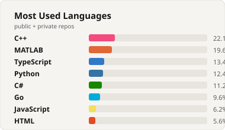

<!--
  Cafe Frame profile skin - matches the personal site palette
  (paper / ink / rose). Drop into bahaaaldin214/README.md.
  Site stays the source of truth: https://bahaaaldin214.github.io/bahaaaldin214/
-->

  

  

<h3 align="center">Systems &amp; research software · Iowa City</h3>

  M.S. Electrical &amp; Computer Engineering (Software Engineering) at the University of Iowa. 
  I build simulation tooling, lab data pipelines, and desktop systems that have to stay reliable.

  <a href="https://bahaaaldin214.github.io/bahaaaldin214/"><strong>Personal site ›</strong></a>
  ·
  <a href="https://www.linkedin.com/in/bahmohammad/">LinkedIn</a>
  ·
  <a href="mailto:bahaaaldinmohammad@gmail.com">Email</a>
  ·
  <a href="https://bahaaaldin214.github.io/bahaaaldin214/Bahaaaldin_Mohammad_Software_Engineer.pdf">Resume</a>

---

### Currently

- **Voss Lab (HBC)** - Software Engineer. BOOST OBS pipelines: JATOS → GGIR → REDCap → Python debriefs; weekly 110 GB+ multi-source sync.
- **IHuman Technology** - Systems Engineer. C#/.NET release delivery, C++ Diligent rendering integration, lighter installs.

### Selected background

- **I-STRIKE / VSR** - MuJoCo inside Santos (215 DOF); maintained a 140+ project C++/C#/.NET/Fortran biomechanical suite.
- **MRI Lab** - Multithreaded Python/BART reconstruction across 4 GPUs (~5× faster).
- Co-author, DHM 2025 - Santos digital human modeling for Army Combat Fitness Test evaluation.

### Built (selected)

| Project | What it is |
| --- | --- |
| [Arteria](https://bahaaaldin214.github.io/bahaaaldin214/#built) | Traffic / road-network structure - chokeholds, bridges, detour importance on OSM graphs |
| [SlamNav](https://bahaaaldin214.github.io/bahaaaldin214/#built) | GPS-denied indoor mapping - shared C++ RTAB-Map + KMP on ARCore / ARKit |
| [AlamirAuto](https://bahaaaldin214.github.io/bahaaaldin214/#built) | Full-stack dealership marketplace - React + Node + MongoDB |
| [Quixotic](https://github.com/bahaaaldin214/Quixotic) | Game engine experiment |

### Live GitHub signal

  
  

  

